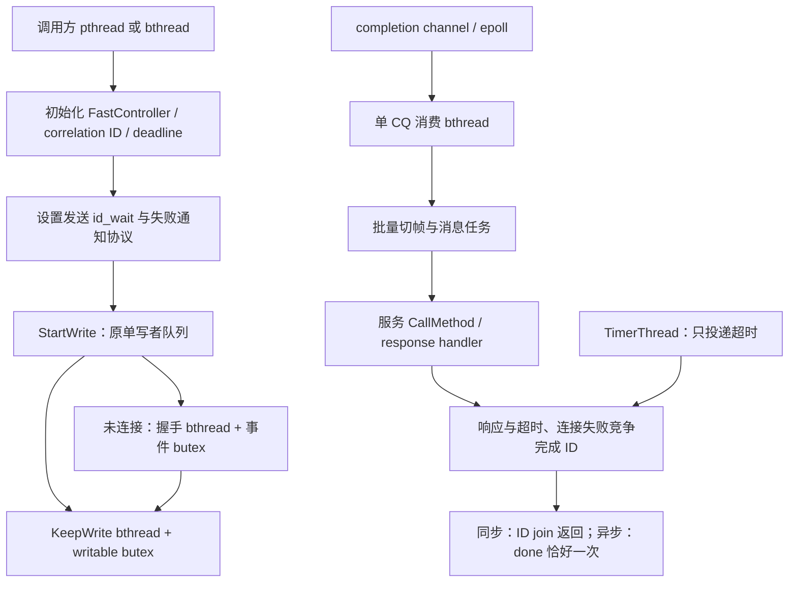

# 将 bthread 基础设施接入 RPC 流程的修改方案

创建日期：2026-10-06；最后修订：2026-10-11。状态：实施前最终审阅稿，尚未实施本文的运行时代码修改。最新源码差异与实施约束见 [brpc 对齐审计](brpc-alignment-audit-2026-10-11.md)。

## 1. 结论与范围

以 brpc 的事件消费、消息分发、发送队列、调用完成和连接生命周期为骨架，复用已经移植的 bthread。迁移的核心是把 RPC 的等待与完成协议接入调度器，而不只是替换 `std::thread`。

本轮方案覆盖客户端调用、按需建连及握手、发送队列、事件驱动 CQ、服务执行、响应、超时、连接失败和关闭回收。继续采用单连接长连接模型；不引入短连接、连接池、SocketMap、RDMA polling 模式。双 QP 大消息路径属于本项目扩展，需要单独证明与 RPC 完成协议的组合正确性。

后台 `HealthCheckTask → WaitAndReset → CheckHealth → Revive` 按用户要求暂缓；不暂停首次按需连接、长连接复用、被动断连感知和失败回收，也不擅自以自创重连算法替代。主动取消及旧接口/旧协议兼容层不纳入本轮。Endpoint 与 Socket 暂不拆类，但必须保持原版各职责的所有权与事件状态边界。

默认直接复用原版算法、原子操作和内存序。下文明确标注有意保留的项目差异与需要补齐的依赖，不能把“简化”作为改写并发协议的理由。

## 2. 分析基线与源码依据

- 初稿 light-rpc 基线：HEAD `2702dd5cec0742a3fd6400af5629874ddc4aecc5` 加当时工作区改动；2026-10-11 复核基线：HEAD `193242810e746bc3924c80e2dd204c00c6ae4e0c`。本次起始工作区仅本文已有未提交修改，保留其 FastController 设计约定。
- brpc：本机 `/home/syt/Desktop/brpc/brpc`，HEAD `d688e7550be4b4c41b9a4dc55add2a2c75be1296`。
- 当前基础设施以 [bthread 移植审计](../../knowledge/bthread-port-audit-2026-10-06.md) 与实际源码为准；[早期移植设计](bthread-port-design.md) 仅作历史参考。
- 继续遵守 [AGENTS.md](../../../AGENTS.md)、[CLAUDE.md](../../../CLAUDE.md) 和 [Endpoint 并发修复记录](../problem-fix/rdma-endpoint-concurrency.md)。

| 流程 | light-rpc 当前入口 | brpc 对照位置（上述提交） | 决策 |
|---|---|---|---|
| 调用发起与等待 | `FastChannel::CallMethod` | `src/brpc/channel.cpp: Channel::CallMethod`；`controller.cpp: Join / HandleTimeout / EndRPC` | 引入最小调用上下文与 Controller，用 ID 完成调用 |
| 连接失败广播 | `FastChannel::OnEndpointFailed`、`pending_` | `socket.cpp: NotifyOnFailed / OnFailed` | 复用 `bthread_id_list`，不另造等待者队列 |
| epoll 分发 | `EventDispatcher::RunEpollLoop` | `event_dispatcher_epoll.cpp: Start / Run`；`socket.cpp: OnInputEvent` | 移植启动属性、事件回调与消费任务边界 |
| 握手读写 | `ReadFromFd / WriteToFd / On*Handshake` | `rdma/rdma_endpoint.cpp: OnNewDataFromTcp / ReadFromFd / WriteToFd`；`socket.cpp: WaitEpollOut` | 补齐事件驱动 butex 等待，再迁移握手任务 |
| 单写者发送 | `StartWrite / StartKeepWrite / KeepWrite` | `socket.cpp: Write / StartWrite / KeepWrite / IsWriteComplete` | 对齐 object_pool、回收与 ID 通知；内联发布；异步连接以 req userdata 接续 |
| CQ 消费 | `OnCompChannelEvent / PollCq` | `socket.cpp: OnInputEvent`；`rdma/rdma_endpoint.cpp: PollCq` | 保持单消费者及 arm/re-poll 协议 |
| 消息与用户代码 | `MessageDispatcher::ProcessNewMessage` | `input_messenger.cpp: QueueMessage / InputMessageClosure / ProcessNewMessage` | 批量创建任务、flush、最后消息执行协议 |
| 服务完成 | `FastServer::OnProcessRequest / ReturnRPCResponse` | `policy/baidu_rpc_protocol.cpp` 的请求处理与响应闭包 | 保持 protobuf 异步 done 与对象所有权 |
| 失败后恢复 | Channel 固定 Endpoint，错误状态不恢复 | `details/health_check.cpp: HealthCheckTask`；`socket.cpp: WaitAndReset / CheckHealth` | 后台健康检查与 Revive 暂缓，记录未对齐；不据此删除连接失败处理 |

源码链接示例：[brpc Channel](https://github.com/apache/brpc/blob/d688e7550be4b4c41b9a4dc55add2a2c75be1296/src/brpc/channel.cpp)、[InputMessenger](https://github.com/apache/brpc/blob/d688e7550be4b4c41b9a4dc55add2a2c75be1296/src/brpc/input_messenger.cpp)、[RDMA Endpoint](https://github.com/apache/brpc/blob/d688e7550be4b4c41b9a4dc55add2a2c75be1296/src/brpc/rdma/rdma_endpoint.cpp)、[连接恢复](https://github.com/apache/brpc/blob/d688e7550be4b4c41b9a4dc55add2a2c75be1296/src/brpc/details/health_check.cpp)。

## 3. 当前尚未贯通的部分

已落地的调度器、butex、mutex/condition_variable、TimerThread、bthread_id、ID list、ResourcePool、object_pool、VersionedRefWithId 足够支撑主要流程。`fastrpc` 已链接 `fast_bthread`；Endpoint 可写等待已经使用 butex，Endpoint 与事件注册已经采用版本化引用。

目前可从代码直接确认：

1. 每个完整消息创建 detached `std::thread`；握手、KeepWrite 和 CQ 消费也通过独立线程执行。
2. `CallMethod` 忽略 `done`，在栈上创建 `PendingRequest`，用 `std::condition_variable` 同步等待；一分钟超时在排队、大消息窗口等待之后才开始计算。
3. 附件保存在共享 Channel 上，不具备并发调用的逐请求隔离；服务端把空 Controller 交给业务。
4. 握手 socket 已设非阻塞，但 EAGAIN 后调用 `usleep(1000)`；握手回调启动后取消 TCP 事件注册。只换成普通 bthread 会继续阻塞 worker，并失去事件驱动等待的基础。
5. Endpoint 失败后原 ID 无法普通 Address，Channel 的 `closed_/connection_error_` 也保持失败，缺少恢复可用状态的流程；记录为恢复未对齐，不意味着必须更换 Endpoint/ID。本轮不实现后台健康检查与 Revive。
6. 大消息容量、回收等待仍使用 pthread 条件变量；handler 返回值在 detached 消息线程中被忽略。
7. WriteRequest 逐次 new/delete；`_pending_keepwrite_req` 作为 Endpoint 全局暂存；`PublishWriteRequest` 只包一条 exchange。按 brpc 成套整改，不能仅替换分配 API 或删除成员。
8. 握手成功后关闭 TCP fd，缺少 brpc 建立连接后继续监测 TCP EOF/错误的入口；此项与健康检查无关，必须补齐。

此外存在两个需在接入前定向验证的代码问题，**本轮没有运行复现，不标为已复现故障**：客户端正常响应解析计算了 payload 长度，却把包含 attachment 的余下 frame 交给 protobuf；大消息接收端在发出 Authority 后才登记 `pending_large_map_`，存在对端快速写回而本地尚未登记的时序窗口。它们应独立修复和验收，避免混入调度性能结论。

`src-resource/fast_shared.cc` 的旧线程池仍参与编译，但在已检查的 `FastChannel → FastRdmaEndpoint → FastServer` 主链中没有使用；不据此改造另一套资源架构。实施前再核对外部使用方。

## 4. 目标流程与执行上下文

图中不表示一次 CQE 就完成一次 RPC。传输完成、消息处理完成、用户 RPC 完成是三个不同事件。

### 4.1 EventDispatcher、CQ 与消息任务

- 对照 brpc `EventDispatcher::Start` 移植其 `BTHREAD_ATTR_NORMAL | BTHREAD_NEVER_QUIT | BTHREAD_GLOBAL_PRIORITY` 启动及停止/join 顺序，核对当前调度器相关分支。**该版本 brpc 的 epoll 循环本身仍调用阻塞 `epoll_wait`，不是由 bthread 自动异步化，也不是默认 PTHREAD 属性。**它会占用执行它的 worker，性能对比时须计算此成本，不承诺所有 worker 均可用于业务。
- 不顺带增加多 tag、多 dispatcher 池；先使用单 dispatcher。初始化 scheduler 后启动 dispatcher，进程退出时先停 dispatcher/所有生产任务，再停止 scheduler。单个 Channel/Server 关闭不调用全局 `bthread_stop_world`。
- CQ 入口保留 `AddReadEvent / MoreReadEvents` 的 `_nevent` 协议与原内存序；只有取得消费权的任务访问 CQ/read buffer。参考 `Socket::OnInputEvent` 选择 urgent 启动路径，不能仅凭“看起来更公平”换调度顺序。
- TCP 主连接与 CQ 在 brpc 中是不同的事件消费对象。合并类不等于合并消费权；保留 TCP 读事件后，不能共用一个 `_nevent` 混算两类事件。
- 保留 4 个 CQ 的项目扩展和现有消费顺序，不引入 `polling_cq`。新事件在退出 CAS 前后到达的接力关系必须保持；归还消费权后不得继续访问由该权保护的 CQ 状态。
- 消息上下文携带 `IOBuf`、handler、Endpoint 引用，优先使用已有 object_pool。参照 `QueueMessage` 使用 `BTHREAD_NOSIGNAL` 成批入队并保证 flush，参照 `InputMessageClosure` 将最后一条消息延后到 CQ 消费任务退出阶段执行。
- **最后消息的持有者必须放在完整 CQ 消费作用域**。不能在每次切帧函数返回时立即调用业务，否则同步业务等待同连接响应时，仍被占用的 CQ 消费权会阻止后续响应处理。逐批处理与创建任务失败时原版 inline fallback 的行为须逐项对照；不能凭空保证任意阻塞业务在该失败路径仍能前进。
- 服务业务默认普通 bthread；不承诺自动 hook 用户的阻塞 syscall。与 brpc 一样，业务需要使用可协作的等待接口；本轮不扩展用户代码备份线程池。
- `MessageHandler` 返回协议需明确：连接级帧损坏使 Endpoint 失败，业务级错误返回 RPC 错误响应。不能继续丢弃返回值，也不能把所有业务错误升级为连接错误。

任务启动前转移堆上下文所有权；子任务可能在 `bthread_start_*` 返回前执行完。成功后启动方不再碰上下文；失败时启动方恢复所有权并执行对应清理。启动 API 返回的错误码不能错误地用 `errno` 代替。参考原版 fallback，分别验证消息、CQ、握手、KeepWrite 的异常分支，不能套用一个无差别 spawn 包装器。

### 4.2 握手：先补齐事件等待，再移除独立线程

推荐成套借鉴 brpc RDMA 握手读事件与 `Socket::WaitEpollOut`，无需为这一流程先引入完整 `bthread/fd.cpp`。

1. 将 TCP 回调职责区分为 connect 完成、握手期间读就绪、写就绪与失败；握手期间保留读事件注册。保持连接状态机单次启动握手，后续事件只更新 generation 并唤醒等待者。
2. 读等待按原版“取 `_read_butex` 快照 → 非阻塞 read → EAGAIN 时带期限 butex_wait”执行，保留短读、EOF、错误语义。移植时明确本项目 EINTR 重试与 errno 映射差异。
3. 为 EventDispatcher 补齐同一注册对象的 EPOLLIN/EPOLLOUT MOD 能力，移植 WaitEpollOut 的“快照 → 注册写事件 → 等待 → 取消写兴趣、保留读兴趣”。当前只有 ADD/DEL 的接口不足。
4. connect 仍只允许一个发起者。按 `ConnectIfNot → KeepWriteIfConnected → AfterAppConnected → KeepWrite` 传递 WriteRequest userdata，并保持其 Endpoint 引用；删除 `_pending_keepwrite_req / FailPendingWrite`。连接请求持有者、事件/超时唯一完成权、SO_ERROR 判定和注册失败回滚一起移植，详见对齐审计 §4.2。
5. 50ms 分段等待是 brpc 握手源码中的等待策略，**不等于总建连超时**。明确连接/握手总 deadline，并对照 `Controller::IssueRPC` 的 connect_abstime 与 RPC deadline 组合方式。不能自行承诺连接期限永远独立于首调用，也不能用新增取消功能任意中断共享建连任务；与原版不同的策略须记录依据。
6. Endpoint 失败先记录错误、唤醒读/写/发送窗口等待者并通知调用失败。按 brpc 移除 OnFailed 对普通 TCP/CQ 注册的统一注销，将最终注销放回引用归零后的回收链，并在关闭 fd 前完成，覆盖 fd 复用与旧事件。
7. 成功握手保留 TCP fd 与读事件，按 `TryReadOnTcpDuringRdmaEst` 处理 EOF、错误与异常数据。异步建连操作按原版在取得唯一完成权后注销自己的等待事件，再执行接续或失败回调；这与普通连接事件的最终注销分开。主 Endpoint 失败也不能跳过已接管请求的回调清理，避免 WriteRequest 所持引用阻止回收。
8. Hello 实现版本、长度与服务端 ACK 校验对齐当前协议；不实现 TCP 数据 fallback。严格拒绝不同实现版本不是支持混合版本兼容。

不使用永久 EPOLLOUT 监听、`bthread_usleep(1000)` 重试或另造 fd waiter map 替代原版协议。若后续出现通用 bthread fd I/O 需求，再单独移植 `fd.cpp` 及其 close/wait 语义。

### 4.3 发送与流控

保留 brpc `StartWrite / IsWriteComplete / ReleaseAllFailedWriteRequests` 算法和首写者快路径；整改范围不仅是替换线程入口：

- WriteRequest 改用已有 `butil::get_object / return_object`，对齐缓存行布局意图，每次复用显式初始化；失败 clear data 后归还，归还后禁止访问。成功/失败回收接口保留真实的通知与清理职责。
- 将 exchange/release、prev_head 判断、next 发布直接写入 StartWrite，删除 `PublishWriteRequest` 等无独立语义的转发。不得改变 UNCONNECTED、消费反转、内存序和并发失败排空协议。
- 连接和 KeepWrite 以 req userdata 转移一份 Endpoint 引用，不为每个排队节点增加不必要的引用操作；删除全局 pending 请求槽必须与连接完成协议同批落地。
- 调用接入时补齐 `id_wait`：按原版成功写请求登记失败通知、失败写请求投递 ID error；不再维护前置登记与成功回收重复登记的两套路径。无关联 RPC 的控制消息使用无效 ID。
- 对齐最小 `_unwritten_bytes / _overcrowded` 计数、阈值及回退，约束异步生产快于发送时的软件积压；不增加通用限流体系。它是过载保护，与 RDMA 硬件窗口不同，性能对比记录是否触发。

保留 `writable_butex_` 的 generation 检查、失败唤醒、`wake_except` 及窗口原子语义；不换成新条件变量，也不为“统一”引入 execution_queue。发送成功入队不表示 RPC 成功；发送失败通过同一 Endpoint 错误与 ID 通知协议到达调用方。

### 4.4 客户端调用：最小 Controller + bthread_id

新增最小 `FastController`，继承 protobuf RpcController，保存逐调用错误、timeout/deadline、request/response attachment、call_id。调用并发度属于 Channel，但这些状态属于每次调用。服务端也提供实际 Controller，避免附件只能经私有 callback 参数访问。本轮不引入主动取消状态机。

对齐 brpc `Channel::CallMethod` 的 Controller 契约：`controller_base` 必须指向非空的 `FastController`，不兼容空指针或其他 protobuf RpcController 实现。protobuf 基类仅用于满足 RpcChannel/生成 stub 的接口签名，不定义或切换网络发送协议。现有传空的调用点与测试随实现迁移为显式创建 FastController。

调用内部状态由 `FastController` 承载：请求关联 ID、response/done、Endpoint 引用、timer ID 和完成阶段；参照 brpc Controller 及其当前调用状态组织，不另设独立 `CallContext`。同步和异步走同一条完成路径，不再维护 Channel 的栈地址 `pending_` 表作为主等待协议。同步调用允许使用栈上 FastController，存活至调用返回；异步调用须保证 Controller/response 存活至完成回调，按下述 ID 与回调协议收尾。

建议的生命周期遵循 brpc：

1. 创建并锁定 ID，完成 Controller 内部调用状态初始化、绝对 deadline、发送请求 id_wait 和必要的发送准备后再释放初始化保护；不能让立即到达的响应看到半初始化状态。
2. 按 brpc WriteRequest 成功/失败回收协议接入 Endpoint 的 `bthread_id_list_add / NotifyOnFailed`。原版 list 与失败检查受同一短锁保护，失败则锁外投递 ID error；直接发送失败不能漏报。失败广播使用匹配锁类型的 list reset 接口，不能持有 Endpoint 容器锁执行用户闭包。
3. 响应使用 `bthread_id_lock` 定位并独占调用。无效 ID/迟到响应丢弃；对端只能回显 opaque ID，需验证来源 Endpoint 属于该调用，不能让其他连接完成它。不要用 trylock 的 EBUSY 当成迟到响应直接丢弃。
4. 超时通过 TimerThread 投递 `bthread_id_error`，不捕获可提前释放的 Controller 裸指针。时间从调用开始计算，覆盖连接、握手、发送窗口、大消息容量及等待响应；保留默认 60s，允许 Controller 配置。统一核对 TimerThread/butex 使用的绝对时间域，不能把 monotonic 时间直接当 realtime 传入。
5. ID error handler 可能在触发线程内同步执行，包括 timer、epoll 或 `SetFailed` 调用线程；借鉴 Controller 的完成任务转交、`about_to_destroy` 和最终销毁协议，避免在 TimerThread 执行用户 done、解析或等待。**删除 timer 返回“正在执行”不等于回调已退出。**
6. 响应、超时和连接失败共享 ID 的唯一终态协议。完成结果先可见，再使同步 `bthread_id_join` 返回；不另加一个与 ID 脱节的 done 原子变量。
7. `done == nullptr`：同步 join；`done != nullptr`：发起后返回，在完成路径执行一次 done，覆盖发送前失败。done 允许删除 Controller/response，所以回调后仅使用提前保存的 ID/内部清理数据。
8. 参考 brpc，异步 ID 最终销毁位于 done 之后，使外部 Join 可观察回调完成；明确 done 内不能 Join 自己。CallMethod 可能在 done 已运行后才退出，要审核返回路径不能再访问用户对象。

首期不引入重试、backup request、命名服务、负载均衡、主动取消或远端业务取消协议。实现 protobuf 基类时明确 `StartCancel / NotifyOnCancel` 不提供本轮调用取消能力，不以空实现伪装成功支持；以后启用时须连同一次通知与闭包生命周期整体实现。同步闭环先落地，基本异步 done 随后沿用同一 ID 协议。

同步 ID join 会释放 bthread worker；从普通 pthread 调用则阻塞该调用 pthread，这是预期行为。

### 4.5 线协议：两端统一升级

**根据 2026-10-11 用户同意前述建议，本稿按同步升级两端编排：rpc_id 改为 64 位，直接回显 `bthread_id_t::value`。本次是方案审阅，尚未实施协议变更。**

- 变更普通请求/响应、Notify、Authority、metadata、CallBackArgs、large-frame map、`wr_id` 读写及测试构帧代码。不能只修改 proto；当前大部分帧头是手工编码。
- `kFrameHeaderBytes` 从 12 变 16；Notify 从 16 变 20；Authority 从 24 变 28；响应 error_code 前缀从 16 变 20，attachment_size 仍另占 4 字节。逐项检查边界、字节序、类型截断和大消息阈值。
- 更新 Hello 的应用实现版本并拒绝混用旧协议；不因 protobuf uint32/uint64 都是 varint 就声称整体线协议兼容。
- RDMA immediate data/rkey 仍为 32 位，不能塞入 64 位 correlation ID；本地 WR 的 `wr_id` 与网络 immediate data 是不同字段。

不实施旧 32 位协议兼容映射、编号回绕管理或双协议自动切换；全部调用点和两端测试同批迁移。若以后有旧端互通需求，再单独立项，不能将截断 bthread_id 作为兼容方案。

### 4.6 大消息：调用生命周期与 DMA 生命周期分离

逻辑大消息名额等待使用已移植的 bthread mutex/condition_variable；data SQ/RQ 容量等待复用已有 butex 检查/唤醒协议。检查与占用名额必须在同一同步协议下完成，不能只把 `CanStartLargeTransfer` 和 `StartLargeTransfer` 两个调用保留为无保护操作。等待谓词包含容量、Endpoint 失败和停止；与调用关联的前置等待还须检查调用 deadline/终态，已授权或已提交资源仍按传输生命周期清理。

客户端异步发起也不能在调用线程中等容量：确需等待时转交持有 Endpoint 引用的发送任务，通过关联 ID 访问 FastController 的调用状态，唤醒后重新检查调用终态；不得在挂起期间依赖可能已被完成回调释放的 Controller 裸指针。不得跨容量等待一直持有 correlation ID 锁，否则超时无法完成。

发送缓冲、已授权 MR、pending-large entry 和窗口名额由传输上下文持有；RPC 超时仅完成用户调用，不直接释放仍可能被设备访问的内存。未提交操作可以撤销并释放名额；已提交操作须等待对应完成或连接 teardown 的确定性清理。迟到 Authority、迟到数据和重复完成都需要明确的状态处理。

`GetLargeFrame` 当前返回解锁后的裸 IOBuf 指针；需要结合 Authority handler、CQ release、超时和失败清理明确所有权。优先用现有引用/对象池承担传输上下文，不直接拿 ID 锁代替 DMA 资源所有权。现有 Channel/Server 的容量检查与占用已经放在各自 mutex 内；重构需审计跨拥有者、完成通知和停止谓词，不能误称当前所有检查均无锁。

另须处理对齐审计 D18：`CutSegFromIOBuf` 只取最多 MAX_SGE 个 BlockRef，调用者只判断负返回值，未保证整个 frame 已提交。不能把前缀发送当完整成功。按 [多 Write 可行性分析](large-rpc-multi-write-analysis.md)，保留一次 Notify/Authority 和完整远端 MR，同一 RC data QP 分段 Write，末段 Write With Immediate 通知整帧完成；接收总长度、SQ 信用、发送完成和部分提交失败必须成套调整。该项目扩展单独验收，不混入线程替换，也不以永久拒绝超 SGE 消息作为最终方案。检查所有准备/发送返回值及 errno 映射。

双 QP 扩展不是 brpc 可原样复制的部分；MR 登记先于向对端发布 Authority、每个名额只归还一次、失败后 DMA 资源的释放边界，均作为本阶段独立验收项。

2026-10-14 明确以下实施原则（详细时序见上述多 Write 文档）：

- 保留逐消息 Authority 许可，不新增 data 通道远端窗口/ACK 协议。接收端先预留本地 RQ 名额，无名额则 bthread 等待；再分配 MR、成功投递接收 WR、登记上下文，最后发送 Authority。最终接收完成后归还 RQ 名额并唤醒，不等业务处理结束；投递返回非零即失败，不能忽略后继续授权。
- SQ 按 Write WR 核算，RQ 按每条消息的一个通知接收 WR 核算，逻辑传输名额另算。两端深度相等不能消除 SQ 满：一个 Authority 许可的消息可以拆成超过 SQ 深度的 WR。SQ 在途量可由提交/完成序号推导，不增加冗余计数；容量不足等待，批尾 SIGNALED 完成归还对应范围并唤醒，整帧最终完成才释放发送帧。
- 当前消息处理在独立线程，不持 CQ 消费权；最后消息优化正常收尾先由 MoreReadEvents 返回 false 释放消费权，再内联处理消息。遵守 brpc 顺序即可，不因这个问题强制新建发送任务。NOSIGNAL/flush 减少逐任务通知，最后完整消息内联省去一个消息任务的创建与调度。
- ProcessNewMessage 已按包头 total_len 拆帧。需要修正的是上游 IOBuf 的有效范围：多 Write 最终完成后引用完整消息长度，不能只引用末次 wc.byte_len；从 Notify 保存长度或从完成后的 MR 包头读取并校验均不需增加线上字段。MR 容量不等于消息长度，不增加数据复制。

### 4.7 关闭、回收与暂缓的后台恢复

保持 `SetFailed` 不等待在途请求/引用排空、`BeforeRecycled` 在最后引用消失后执行的设计；不称其严格非阻塞：失败回调及最终回收可能同步执行。服务端 request/response/Controller 和 Endpoint 引用由响应闭包接管，存活到响应收尾不再使用为止，可以在 done 执行内部释放；业务调用 done 后不得继续访问已转移所有权的对象。

内部区分停止和等待：停止拒绝新调用、停止接受新连接并广播失败，外部 Close 用 bthread 条件变量等待已有回调和引用退出。普通连接的 TCP/CQ 注册在回收链最终注销，不在 OnFailed 中统一提前注销；监听 fd 停止接收与临时连接操作完成各按原版自身流程注销。此结论与连接回调所有权一起落地，详见 [对齐审计 §5.1](brpc-alignment-audit-2026-10-11.md#51-d20失败通知与事件注销按-brpc-分层)。不强制给每个类新增公共 Stop/Join，也不支持回调内同步析构自身或任意并发析构。确需公开 Stop 时由外部所有者等待；不能新增管理线程/延迟销毁队列来支持范围外的析构用法。

用户明确暂缓后台 `HealthCheckTask → WaitAndReset → CheckHealth → Revive`，对应实现、恢复时间测量和“服务端上线后同一 Channel 自动恢复”的验收移出本轮。仍核对首次按需连接、连接复用、失败广播、被动断连与回收；不将“恢复暂缓”解释成失败通知也可不做。

后续重启恢复工作时再审计恢复引用、AddressFailedAsWell、reset 和 Close 协议，不能照抄 expected_nref 常数。同一 Channel 失败后的重新建连策略保持为明确未对齐项，不预先实施“新 Endpoint 世代”或其他替代方案，不重放已失败 RPC。

## 5. 锁与 TLS 的使用规则

| 场景 | 方案 | 原因/限制 |
|---|---|---|
| RPC 完成仲裁与等待 | bthread_id / join | 直接对应 brpc 调用协议 |
| 写窗口、data SQ/RQ 容量等待 | 现有 butex 协议 | 复用 generation 与唤醒语义，各自容量谓词独立；失败/停止唤醒相关等待者 |
| 逻辑大消息名额、停止后排空等待 | bthread mutex + condition_variable | bthread 内等待不占 worker；谓词必须受保护 |
| ID list、注册表等短临界区 | 对照原版使用 pthread mutex / 对应已移植 Mutex | 不在锁内等待、解析大消息或执行用户回调 |
| 连接资源状态、large-frame 容器 | 逐处界定临界区后选择 | 不能简单把所有 std::mutex 换 FastPthreadMutex |
| 全局一次初始化 | 保留短 once 或使用已移植 once | 审核初始化是否阻塞/递归；避免全局析构次序反转 |

FastPthreadMutex 竞争时仍可能阻塞 worker。此前锁基准不能证明它适合所有 RPC 等待点，见 [mutex 基准](../../knowledge/brpc-mutex-benchmark.md)。

IOBuf、block_pool、large_block、object_pool/ResourcePool 的 pthread TLS 缓存按 brpc 思路保留。检查 bthread 挂起前是否保存 TLS 缓存地址并在迁移 worker 后继续使用；业务请求状态应放 FastController 或 bthread key，不能依赖 `thread_local`。内存注册、资源分配等 provider 调用也可能较慢，bthread 不会自动将它们异步化；首期测量耗时，不额外发明专用线程池。

## 6. RDMA 规范约束

调度迁移保持当前 CQ 顺序、通知策略及成功/失败资源清理约束；B5 的现有大消息缺陷单独处理，不把传输变更混入调度性能结论。初稿的 [Release 1.2.1 规范副本](https://www.afs.enea.it/asantoro/V1r1_2_1.Release_12062007.pdf) 完整访问被拒绝；2026-10-11 已读取可获取的历史 [InfiniBand Architecture Vol.1 Release 1.0.a](https://pllab.cs.nthu.edu.tw/~kyshieh/course/cs5404/page1/page5/files/vol1r1a2.pdf) §11.4.2.2（535～536 页）核对通知语义。Linux API 细节另对照 rdma-core 原始手册，不能把其 ACK API 误认为规范原文，也不声称已核对当前完整标准。

- 通知为 one-shot；arm 前已经存在的 CQE 不保证产生新的通知。因此保持 arm 后再次 poll，以及退出时检查新事件的协议。[libibverbs 通知说明](https://www.man7.org/linux/man-pages/man3/ibv_req_notify_cq.3.html)
- 每次成功 `ibv_get_cq_event` 都形成一次 ACK 义务；允许累计后批量 ACK，意外 CQ 也须 ACK；未成功取出的通知不能计数。销毁前处理已取出但尚未 ACK 的事件。[rdma-core get/ack 手册](https://github.com/linux-rdma/rdma-core/blob/master/libibverbs/man/ibv_get_cq_event.3)
- 普通非 inline 发送缓冲不能因用户 RPC 超时立即复用；按 WR 完成或 teardown 协议处理。inline 的例外不推广到非 inline 或接收 MR。[rdma-core post_send 手册](https://github.com/linux-rdma/rdma-core/blob/master/libibverbs/man/ibv_post_send.3)

跨 QP 的先后不能用 C++ 加锁或 bthread 调度顺序替代传输证明；本轮不宣称已完成双 QP 全量规范审计。若后续修改 verbs 操作或 MR teardown，须补齐相应规范条款核对后实施。

## 7. 分阶段提交与验收

以下 B0～B7 替代初稿 P0～P5。每批保持可构建、可回归，记录 [差异台账](brpc-alignment-audit-2026-10-11.md) 的对应 D 编号；不跨批顺带扩展功能。批内可以拆提交，但不能提交可运行且生命周期不闭合或 ID 被截断的中间状态。

| 批次 | 主要内容 / 差异编号 | 完成标准 |
|---|---|---|
| B0 基线与独立缺陷 | 固化工作区/编译配置；修正压测工具；响应附件边界与帧错误区分（D10、D13、D22） | 先修影响测量的工具问题再采基线；纯构帧回归。Authority 时序和大消息 SGE 问题登记到 B5，不用未验证的大消息结果宣称性能 |
| B1 发送节点与队列 | object_pool、字段重置/布局、成功失败回收、内联 exchange，移除纯转发（D01、D03） | 生产与测试节点同批改池化；并发发布、FIFO、失败排空、缓冲恰好一次释放回归；此批不提前删 pending 槽 |
| B2 建连与握手协议 | 回调 userdata、Endpoint 引用、唯一完成权、连接 deadline、事件 MOD、握手 butex、TCP 持续读事件、版本/ACK 校验、注销时机对齐（D02、D05～D08、D20） | 删除 pending 槽及回收兜底；普通 TCP/socketpair 验证同步/异步失败、超时、Close 和回调提前执行。普通事件回收时注销、连接操作完成时注销自身事件，两条路径与回调所有权同批闭合。TCP 和 CQ 消费状态独立；任务载体切换前先完成可协作等待 |
| B3 bthread 执行链 | dispatcher、握手、KeepWrite、CQ、批量消息与最后消息（D04、D08～D10） | urgent/background/NOSIGNAL/flush 与原版边界一致；启动失败逐入口闭合；消费权 CAS 前后事件接力和最后消息作用域回归 |
| B4 调用完成与线协议 | FastController、bthread_id/list/timer、WriteRequest id_wait、64 位双端帧、逐调用附件、最小积压限制（D11～D16） | B4a 同步 ID join 与两端协议一次配套切换；B4b 同一协议支持基本异步 done。ID timer 正式声明、迟到响应、响应/超时/失败竞争和 done 释放用户对象验证；不保留旧 pending_map/旧附件兼容层 |
| B5 现有大消息闭环 | 多 Write 完整覆盖、末段 immediate、完整 IOBuf 长度、本地 SQ/RQ 容量等待、准备接收并登记后 Authority、部分失败及传输拥有权（D17～D19） | 验证超过 SQ 深度的分批推进、RQ 满时暂缓授权及恢复、失败唤醒、整帧唯一回收；不新增远端窗口 ACK。纯状态测试与硬件集成分开；异步等待不持 ID 锁，不依赖可被 done 释放的 Controller 裸指针 |
| B6 失败与关闭贯通 | 唤醒所有等待、连接完成收尾、业务闭包/回收引用、Close 协作等待（D20） | 验证 B2 已对齐的失败通知与注销分层：失败后普通事件拒绝新工作、独立连接操作完成不丢失、最终注销先于关闭 fd。对端退出、本端关闭、旧事件和延迟 done 无泄漏/自等待。不实现后台 health-check→Revive |
| B7 全链与性能 | 同步/异步、单 Channel 多 outstanding、普通与大消息、冷启动/稳态分开（D22 及所有保留差异） | 对比旧调度、改造后、brpc 事件驱动单连接；记录配置、错误率和原始数据。没有实测不宣称性能等价 |

B1～B3 是执行与发送基础接入；B4～B6 完成后才能称本轮范围内 RPC 接入闭环。brpc 完整单连接恢复仍未对齐，单独列出，不把 health-check→Revive 当成 bthread 接入验收前置。

每批提交说明必须包含：原版函数与提交、D 编号、裁剪项、保留差异、正确性与性能影响、实际验证。改运行时代码后完成对应构建/测试；文档审计阶段只检查引用与差异，不以历史测试结果冒充本轮验证。

### 7.1 纯逻辑/普通 TCP 测试

- 保留已有 scheduler、写队列、版本引用、事件、窗口唤醒回归；混合 pthread/bthread 调用。
- socketpair/非阻塞 TCP 验证握手短读/短写、先到事件、EAGAIN、EOF、deadline、失败唤醒、注册失败及 fd 世代复用；不调用 RDMA verbs。
- 同一调用的响应/超时/失败两两竞争；初始化期间立即响应；timer 删除失败/执行中；ID 回收后迟到响应；每条完成路径 done 恰好一次。不增加主动取消测试矩阵。
- 异步 done 删除 Controller，验证返回路径无悬空访问；done 发起新调用、业务嵌套同步 RPC 作为扩展回归，不为此增加通用重入框架或任意阻塞 syscall 支持。
- 多请求共享 Channel 的附件隔离；纯构帧解析验证 64 位大值/截断、分段 IOBuf、错误长度、payload 与附件边界、旧协议拒绝。
- 大消息容量的纯状态逻辑：超时前后取得名额、Stop 期间等待、归还一次；不通过 mock verbs 把真实 verbs 场景包装成单测。
- 生命周期纯逻辑：失败注册与广播竞争、旧 Endpoint 的通知不污染新世代、回调结束后才触发最终回收。

### 7.2 RDMA 硬件集成验收

凡实际调用 `ibv_post_send / ibv_poll_cq / ibv_post_recv` 等 verbs 的场景放入集成验证，不编成单元测试：

- inline/medium/large 各边界、控制/数据两 QP、并发超过大消息窗口；共享单 Channel 多调用及响应乱序。
- arm/re-poll 空隙、空通知、累计 ACK 与关闭、WC 错误、发送途中断连、握手失败/超时。
- 用户超时先于 send WC、迟到 Authority/数据完成、MR/IOBuf 未过早复用且最终无泄漏。
- 服务端未启动时连接按期限失败；握手后客户端退出触发服务端失败收尾；故障请求只完成一次且不自动重放。服务端继续接受独立新连接；同一 Channel 后台自动恢复不在本轮验收内。
- 异步业务长时间持有 done、关闭与回调并发、多个 Endpoint 共存时互不阻塞。

### 7.3 性能与可比性

对比“当前实现”“bthread 接入后”“brpc 的事件驱动 CQ + 单连接”，保持硬件、CPU affinity、worker 数、消息大小、连接数、并发 outstanding、编译优化和业务负载一致；排除 brpc polling 模式。

当前压测每个 pthread 一个 Channel，主要测多连接同步请求；补充固定一个 Channel 的多 pthread、多 bthread、异步并发组，避免把连接数变化当成 bthread 收益。分别统计成功 QPS、P50/P99/P999、错误/超时、CPU、系统线程数、上下文切换及内存峰值；先预热，再多轮测量并保留原始数据。连接建立/回收单独测量，后台恢复时间暂不测；双 QP 大消息与 brpc 的额外路径差异单独解释。

收益预期是减少逐消息系统线程创建、在等待时释放 worker、减少通知次数；任务栈、ID/timer 和上下文也有成本。没有实测数据前不承诺吞吐或尾延迟必然提升，也不把先前 mutex 微基准代替 RPC 结果。

## 8. 已确认的实施边界与进度

用户于 2026-10-17 确认方案审阅结束并授权开始实现：按 B0～B7 推进；对象池、异步 req userdata 与内联发布按原版成套实施；非空 FastController；两端统一 64 位 ID；基本同步/异步调用；默认 60s 从调用开始计时；附件仅归逐调用 Controller。

后台健康检查→Revive、主动取消、重试及兼容层不做；Endpoint/Socket 拆类后置。新发现的必要依赖按现有移植原则处理，记录到差异台账；不因“更保险”加锁、加状态或改内存序。

B0 的帧错误区分、响应附件解析和压测工具修复已落地；2026-10-18 完成 B1 对象池、节点复用/回收及发布内联整改，构建、9/9 写队列回归和 7/7 CTest 目标通过。环境无 RDMA 设备，硬件性能基线待采集；B2～B7 尚未实施，详见 [批次实施记录](batch-implementation-log.md)。
